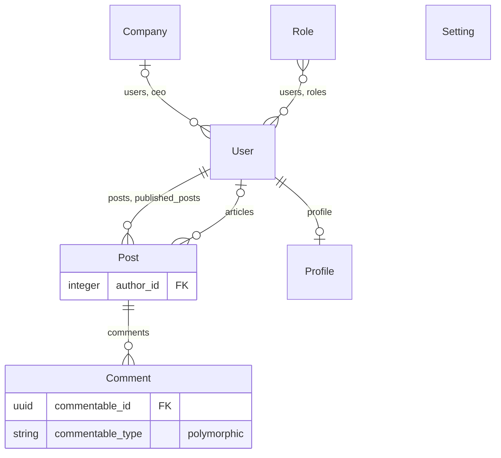

# rails_mermaid_erd

Reads your Rails models and writes a **Mermaid ER diagram** (`erd.mmd`) of their relationships.

- Model names only — no columns, except foreign keys that don't follow convention (see below).
- `belongs_to`, `has_many`, `has_one`, `has_and_belongs_to_many` are drawn; anything with `through:` is ignored.
- A `belongs_to` and its inverse `has_many`/`has_one` are merged into a single line.
- Files are parsed statically with Prism: the app is never booted and no database is needed.

## Install

```ruby
# Gemfile
group :development do
  gem "rails_mermaid_erd", path: "path/to/rails_mermaid_erd"   # or git:/rubygems once published
end
```

## Use

```sh
bin/rails erd:mermaid                       # writes erd.mmd in the app root
bin/rails erd:mermaid OUTPUT=docs/erd.mmd EXCLUDE=PaperTrail::Version FK_MODE=explicit

# or without Rails loaded at all
bundle exec rails_mermaid_erd .               # writes ./erd.mmd
bundle exec rails_mermaid_erd . -o -          # print to stdout
bundle exec rails_mermaid_erd . -m app/models -m engines/billing/app/models -x Setting
```

From Ruby: `RailsMermaidErd.generate(root: Rails.root.to_s).mermaid`.

## Output



| Notation | Meaning |
|---|---|
| `\|\|--o{` | `has_many`, `belongs_to` required |
| `\|o--o{` | `belongs_to ..., optional: true` |
| `\|\|--o\|` | `has_one` |
| `}o--o{` | `has_and_belongs_to_many` |

The label is the association name(s) on the "has" side, or the `belongs_to` name when there is no inverse.

### When foreign keys are shown

Default (`non-conventional`): a foreign key is drawn on the child entity when its column is not
`<parent_model>_id` — e.g. `belongs_to :author, class_name: "User"` (`author_id`),
`foreign_key: :editor_uuid`, and polymorphic `*_id` / `*_type` pairs. A non-default
`primary_key:` is drawn on the parent as `PK`.

`--fk-mode explicit` (`FK_MODE=explicit`): only when `foreign_key:` is written in the code
(plus polymorphic keys).

Column types come from `db/schema.rb` when present; otherwise `bigint` / `string`.

## Polymorphic associations

`belongs_to :commentable, polymorphic: true` is linked automatically to every model that declares
`has_many :comments, as: :commentable`.

Audit-style ones (`belongs_to :updated_by, polymorphic: true`) usually have no `as:` counterpart, so
the target model can't be read from the code. Tell the gem which models they point to, in any of
these ways (the first that matches wins):

1. **Option / env** – `-p updated_by=User,Admin -p Notification.created_by=User`
   or `POLYMORPHIC='updated_by=User,Admin;Notification.created_by=User'` for the rake task.
2. **Config file** – `config/rails_mermaid_erd.yml` (picked up automatically, or `-c FILE`):

   ```yaml
   polymorphic:
     updated_by: [User, Admin]          # every model's belongs_to :updated_by
     created_by: [User]
     Notification.created_by: [User, System]   # overrides the line above for one model
   exclude: [PaperTrail::Version]
   ```

3. **From the database** – `bin/rails erd:mermaid POLYMORPHIC_FROM_DB=1` reads
   `SELECT DISTINCT updated_by_type` for each association not mapped above.

Anything still unmapped is not lost: it's drawn on its model as `updated_by_id FK` /
`updated_by_type "polymorphic"`, with a warning naming the key to add.

## Handled

`class_name:` (string, symbol, `User.name`), `foreign_key:`, `primary_key:`, `as:`, `polymorphic: true`,
`optional:` / `required:`, scopes (`-> { ... }`), `with_options` blocks, associations inside
`ActiveSupport::Concern` `included do` blocks, namespaced models (`Admin::User`, quoted in the output),
Rails-style constant lookup, `self.table_name`, abstract classes (skipped), STI subclasses.

## Limitations

- Associations created dynamically (metaprogramming, loops, non-literal `class_name:`) can't be read; they're reported as warnings.
- Polymorphic targets without an `as:` inverse need mapping (see above) or `POLYMORPHIC_FROM_DB=1`.
- Models from other gems aren't scanned unless you pass their paths with `-m`.

## Development

```sh
bundle install && bundle exec rake test
```
